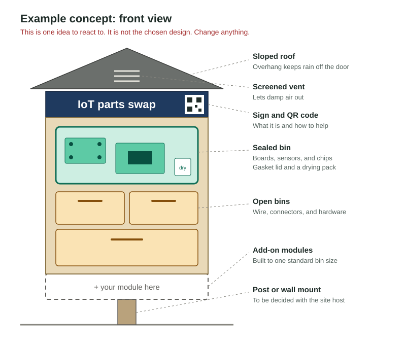

# IoT Swapatron 5000

**A free electronics parts swap box, built by the community in Fishers, Indiana.**

**Take a part. Build something. Pass it on.**

> **Nothing is decided yet.** The box does not exist. The design, the rules, the name, and the dates are all open. We are collecting ideas until **Sunday, January 10, 2027**. [Have your say](docs/have-your-say.md).

## The idea

Think of a neighborhood book box, but for dev boards, sensors, wire, and connectors. It would sit outside the Indiana IoT Lab. The community would design it, build it, stock it, and look after it.

*One example sketch to react to. It is not the chosen design.*

## Who it is for

- **New to electronics?** Get parts for free, with a note on what each one is and what to build first.
- **Been building for years?** Give your spare parts a second life, and start someone off with what you know.

## Help shape it

You do not need to code. Everything here works on a phone. Never used GitHub? [This two minute guide](docs/have-your-say.md) shows you where to tap.

| I want to... | Do this |
|---|---|
| Give my opinion | Read the [open questions](DECISIONS.md) and comment on one |
| Draw a design | Use the [printable design sheet](hardware/designs/template-blank.svg), then [share your sketch](../../issues/new?template=design-sketch.yml) |
| Share an idea | [Open an idea](../../issues/new?template=idea.yml) |
| Give a part or supply | Check the [wishlist](bom/BOM.csv), then [pledge it](../../issues/new?template=pledge-a-part.yml) |
| Ask for a part I need | [Ask for a part](../../issues/new?template=ask-for-a-part.yml) |
| Take on a job | Pick one from the [bounty board](BOUNTIES.md) |
| Spread the word | Use the [share kit](docs/share-kit.md) |

Every contribution earns a spot on the [Contributors Wall](CONTRIBUTORS.md).

## The proposed timeline

| When | What |
|---|---|
| Now to Jan 10, 2027 | Listen. Collect ideas and sketches |
| Jan 11 to Jan 31, 2027 | Decide, in the open |
| Feb 1 to Mar 14, 2027 | Gather materials |
| Sat Mar 20, 2027 | Build day, indoors at the lab |
| Sat Apr 10 and Sat Apr 24, 2027 | Install, then opening day |

Every date is a proposal and depends on the lab approving the site. [Full timeline](ROADMAP.md).

## Stuck?

[Ask for help](../../issues/new?template=help.yml). No question is too small.

## Go deeper

| Page | What it is |
|---|---|
| [VISION.md](VISION.md) | The dream: where this could go. Open for anyone to edit |
| [DECISIONS.md](DECISIONS.md) | Every open question, and how decisions get made |
| [ROADMAP.md](ROADMAP.md) | The proposed timeline in full |
| [BOUNTIES.md](BOUNTIES.md) | Jobs with points, levels, and badges |
| [ASKS.md](ASKS.md) | Ask for a part, or fill someone else's ask |
| [bom/](bom/README.md) | The draft wishlist of materials |
| [hardware/](hardware/README.md), [electronics/](electronics/README.md), [software/](software/README.md), [ux/](ux/README.md) | The four teams and their open questions |
| [docs/build-day.md](docs/build-day.md) | The build day plan |
| [docs/maintenance.md](docs/maintenance.md) | The recurring upkeep schedule and rota |
| [docs/swap-rules.md](docs/swap-rules.md) | Draft rules for what goes in the box |
| [docs/learn-github.md](docs/learn-github.md) | Learn GitHub in 15 minutes |
| [CONTRIBUTING.md](CONTRIBUTING.md) and [GOVERNANCE.md](GOVERNANCE.md) | How contributing works, and draft roles |
| [AGENTS.md](AGENTS.md) | A briefing for AI assistants. Paste this to yours: "Read AGENTS.md in github.com/Fishers-Founders-United/Swapatron5000 and help me contribute." |
