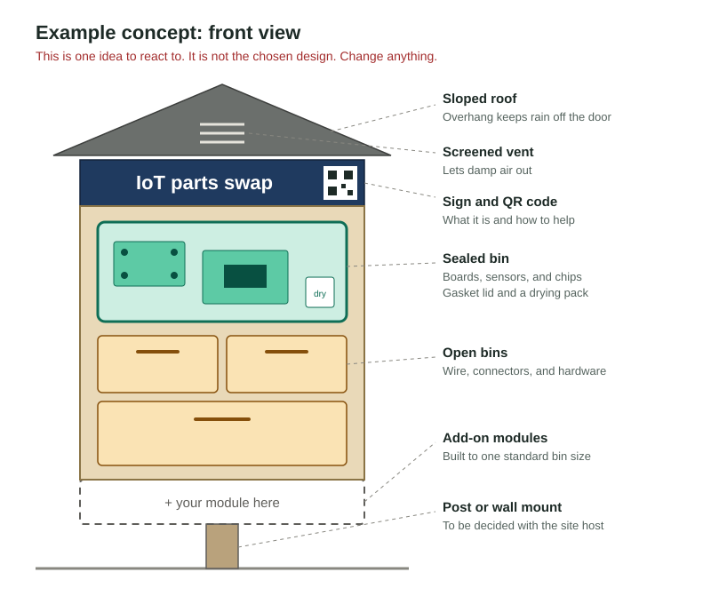

# Designs

Drawings of the box live here. Nothing in this folder is the chosen design. Every drawing is an idea to react to.

## Start from the example

[example-concept/concept-front.svg](example-concept/concept-front.svg) is one idea, drawn to get the conversation going. Copy it, change it, or ignore it.

## Four ways to contribute a drawing

| Way | How | You need |
|---|---|---|
| 1. Print and draw | Print [template-blank.svg](template-blank.svg), draw on it, photograph it, and [share your sketch](../../../../issues/new?template=design-sketch.yml) | A printer and a pencil |
| 2. Draw on anything | A napkin, a whiteboard, a tablet. Photograph it and [share your sketch](../../../../issues/new?template=design-sketch.yml) | A phone |
| 3. Mark up the example | Save the example picture, draw over it in any photo or notes app, and share it the same way | A phone |
| 4. Edit the drawing file | Open `concept-front.svg` in Inkscape (free), change it, and add it in a pull request | A computer |

Ways 1 to 3 need no software and no GitHub skills beyond filling in a form.

## About the drawing files

The drawings are SVG files. An SVG is a picture stored as text, so:

- GitHub shows it as a picture
- Anyone can open it in a free drawing program such as Inkscape
- Changes are easy to see and review
- Each part of the box is its own named group in the file (`roof`, `sign`, `sealed-bin`, `open-bins`), so you can move or swap one part without redrawing the rest

## Adding your own design folder

Make one folder per design, named after it, for example `hardware/designs/cedar-lean-to/`. Include:

- A picture or drawing (SVG, PNG, or a photo)
- A short `README.md`: what it is, the rough size, and the materials
- If you made CAD files, at least one open format (STEP, SVG, or DXF)

## Drawings we would love to see

- A side view and a top view of any design
- A wall-mounted version
- A close-up of how an add-on module attaches
- A view showing a wheelchair user reaching the bins
- The sign and the bin labels
